# Sunlight

[English](README.md) · [빠른 시작](#빠른-시작) · [AI 설정](#ai-설정) · [MIT 라이선스](LICENSE)

Sunlight는 내 컴퓨터에서 쓰는 논문 리더입니다. 읽다가 막히는 문단을 선택해 Claude에게 물어보세요. 답에 원문과 대조한 인용이 있으면, 눌러서 PDF의 해당 문장을 확인하고 읽던 곳으로 돌아갈 수 있습니다.

| 밝은 테마 | 어두운 테마 |
| --- | --- |
| [](docs/screenshots/reader-light.png) | [](docs/screenshots/reader-dark.png) |

## 빠른 시작

Linux x64(glibc)에서 **Node.js 22.23.5와 npm 10**을 준비하세요. nvm을 쓴다면 내려받은 폴더에서 `nvm install`을 실행하면 됩니다. 같은 폴더에서 아래 세 줄을 실행하세요.

가장 빠른 방법은 [Node.js](https://nodejs.org) 22 이상을 설치한 뒤:

```sh
./start.sh
```

설치·빌드·실행을 한 번에 합니다. 찍히는 `http://127.0.0.1:…` 주소를 열고, 끌 때는 Ctrl+C를 누르세요.

Node는 [nodejs.org](https://nodejs.org)나 nvm으로 설치하세요(배포판 `npm` 패키지는 깨져 있는 경우가 많습니다). 직접 단계별로 하려면:

```sh
npm ci
npm run build
npm run start:user -- --user-data
```

서재에 arXiv ID를 붙여 넣거나 **PDF 올리기**에서 파일을 고르세요. 50 MiB까지 끌어다 놓을 수도 있습니다. 논문을 가져오면 AI를 설정하기 전에도 읽고, 문장에 표시하고, 노트를 남길 수 있습니다. 다 읽고 서버를 끄려면 터미널에서 **Ctrl+C**를 누르세요. [서재 열기](http://127.0.0.1:4310/)

기본 포트를 이미 쓰고 있다면 `SP_PORT=4595 npm run start:user -- --user-data`로 실행하세요. [4595번 포트로 열기](http://127.0.0.1:4595/)

### Windows (네이티브)

Windows 네이티브 지원은 새로 추가되었습니다 — **테스트 참여를 환영하며, 아직 Windows에서 충분히 검증되지는 않았습니다.** 문제가 생기면 아래 WSL에서 Linux 방식 그대로 쓸 수 있습니다.

**[Node.js 22 LTS](https://nodejs.org)**(Windows `.msi` 설치 파일)가 필요하고, 저장소를 clone하려면 **[Git for Windows](https://git-scm.com/download/win)**가 필요합니다(또는 저장소를 ZIP으로 받아 풀어도 됩니다). 그런 다음 clone하거나 압축을 푼 폴더에서 **PowerShell**로:

```powershell
.\start.ps1
```

설치·빌드·실행을 한 번에 합니다. PowerShell에서 스크립트 실행이 막혀 있다면 `powershell -ExecutionPolicy Bypass -File .\start.ps1`로 한 번 실행하세요. 찍히는 `http://127.0.0.1:…` 주소를 브라우저에 붙여 넣어 열고, 끌 때는 창에서 **Ctrl+C**를 누르세요.

직접 단계별로 하려면:

```powershell
npm ci
npm run build
npm run start:user -- --user-data
```

논문·노트·설정은 `%APPDATA%\Sunlight`에 쌓입니다(그 옆에 `study_paper-config\`, `study_paper-secrets\`). DB 엔진(better-sqlite3)은 64비트 Windows용 미리 빌드된 바이너리를 함께 배포하므로, 일반적인 설치에는 컴파일러가 필요 없습니다. `npm ci`가 SQLite 네이티브 모듈을 불러오지 못한다고 할 때만(흔치 않은 Node·CPU 아키텍처 조합) **[Visual Studio Build Tools](https://visualstudio.microsoft.com/downloads/)**의 “C++를 사용한 데스크톱 개발” 워크로드를 설치하고 `npm ci`를 다시 실행하세요.

### Windows (WSL)

위 Linux 방식은 **WSL**(Windows Subsystem for Linux) 안에서 그대로 동작합니다. WSL 배포판에 Node 22를 설치하고 `./start.sh`를 실행한 뒤, 찍히는 `http://127.0.0.1:…` 주소를 Windows 브라우저에서 여세요.

## 논문 한 편 읽기

파일로 올린 논문은 PDF에 기록된 제목이나 파일명으로 표시됩니다(서재에서 고칠 수 있습니다). 책갈피가 있으면 목차로 쓰고, 없으면 배치에서 절 제목을 찾습니다. 스캔본은 목차나 선택할 글자가 없을 수 있습니다. LaTeX 원문이 없는 PDF는 인용을 미확인으로 두고 수식 깊이 읽기를 제공하지 않으며, 큰 문서의 AI 설명에는 본문 일부를 발췌해 씁니다.

### 문장 선택해서 묻기

| Light | Dark |
| --- | --- |
| [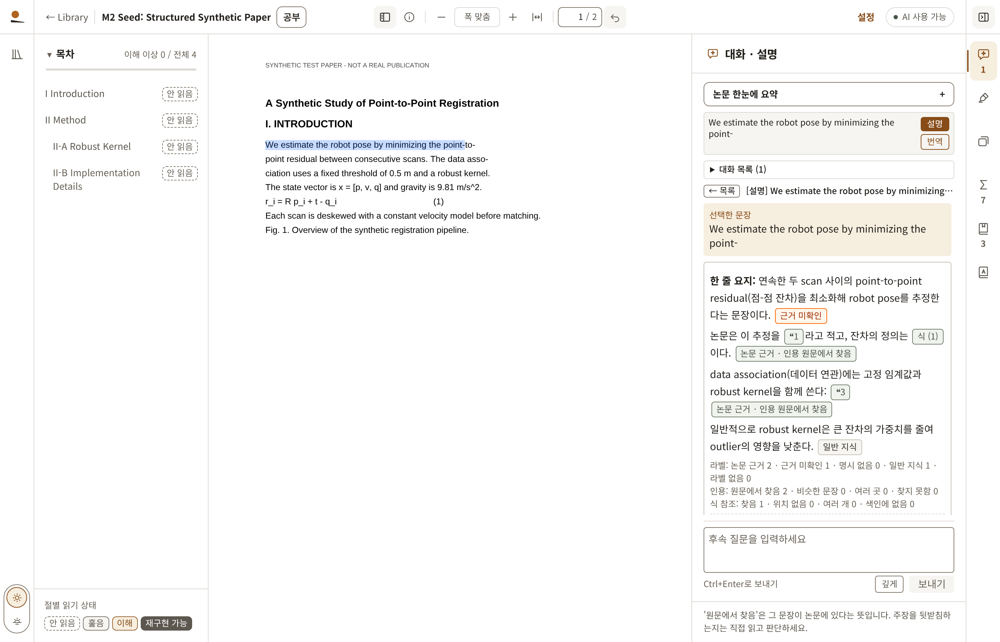](docs/screenshots/ai-grounded.png) | [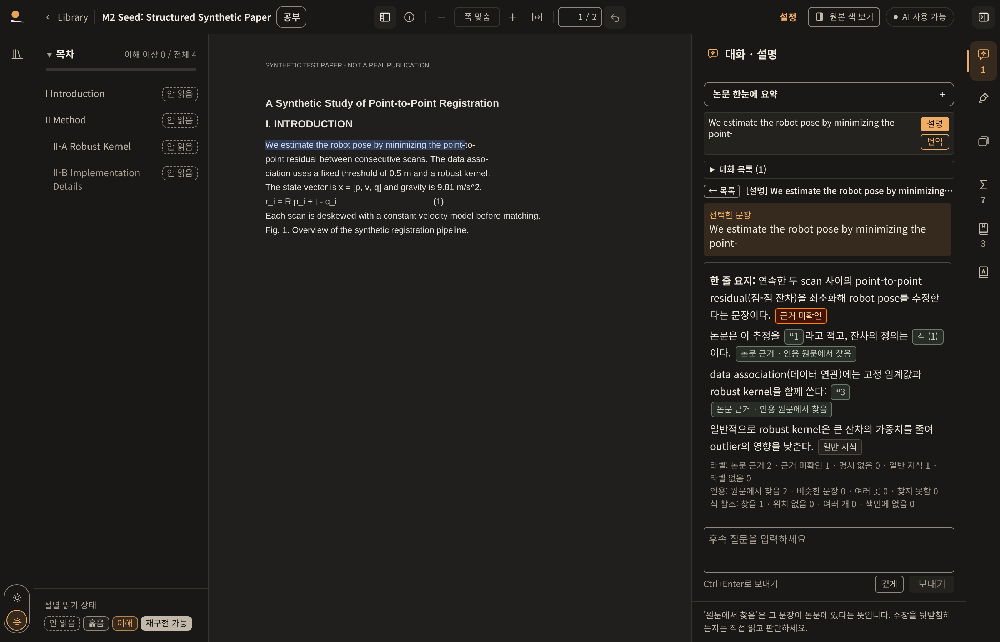](docs/screenshots/ai-grounded-dark.png) |

문장을 드래그하고 **E**(설명), **T**(번역), **C**(직접 질문)를 누르세요. 그림의 일부만 묻고 싶으면 **Ctrl**을 누른 채 그 부분을 드래그합니다(Dark 테마에서도 원래 색으로 돌려볼 수 있습니다). 답변의 각 문장에는 출처 라벨(논문 근거 / 일반 지식)이 붙고, **원문에서 찾음** 인용을 누르면 PDF의 그 줄로 이동합니다. PDF 옆에서 낯선 기호는 표기 카드로, 다음 식의 전제는 가정 카드로 찾고, 식 번호로 이동하거나, 용어를 용어집에 저장하거나, 문장을 하이라이트하고 **N**으로 노트를 남길 수 있습니다.

### 논문 한눈에 요약

| Light | Dark |
| --- | --- |
| [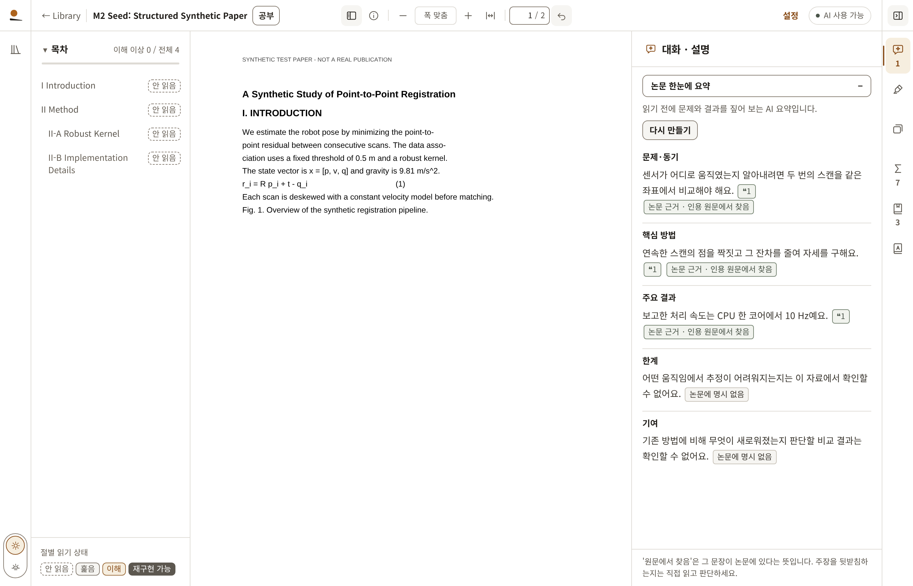](docs/screenshots/overview.png) | [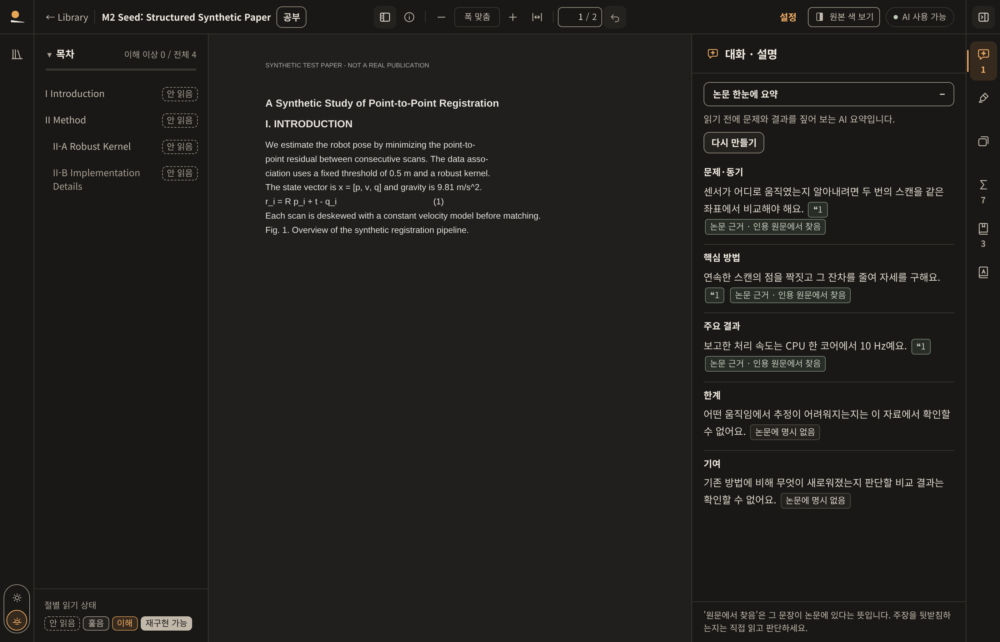](docs/screenshots/overview-dark.png) |

AI 패널에서 **논문 한눈에 요약 → 요약 만들기**를 누르면 한 화면 요약이 나옵니다. 문제·동기, 핵심 방법, 주요 결과(논문이 보고한 수치 포함), 한계, 기여를 각각 한 단락으로 읽습니다. 각 항목에는 출처 라벨이 붙고, 논문에 없는 내용은 지어내지 않고 표시합니다. 페이지를 떠나도 계속 생성되고, **다시 만들기**로 교체합니다.

### 선택에서 복습문제로

| Light | Dark |
| --- | --- |
| [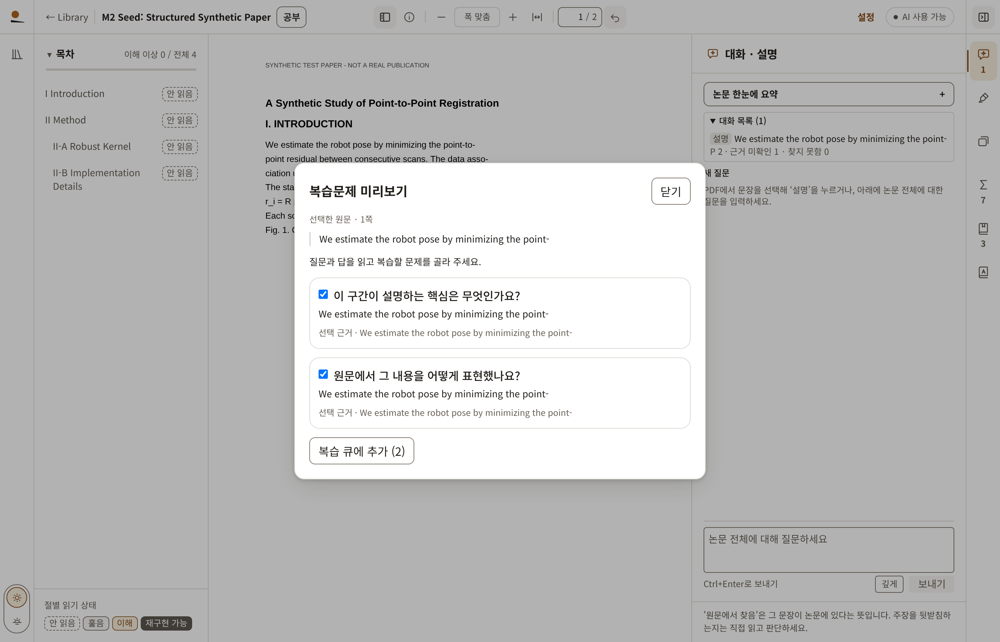](docs/screenshots/review-questions.png) | [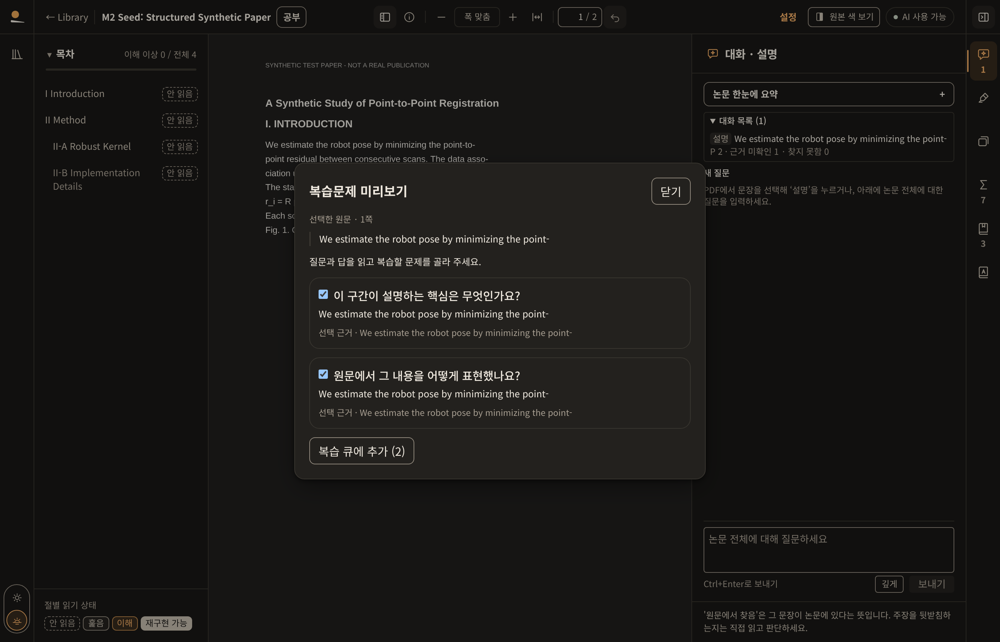](docs/screenshots/review-questions-dark.png) |

문장을 선택하고 **Q**(또는 **문제 만들기**)를 누르면 그 글에서 복습문제를 만듭니다. 각 문제에는 만들어진 **선택 근거**가 그대로 표시됩니다 — 문구는 반드시 선택한 글에서 나와야 합니다. 원하는 문제만 골라 복습 큐에 넣고, 서재의 **복습**에서 나중에 풉니다. **원문 보기**로 하이라이트된 원문으로 돌아갑니다.

### 직접 구현해 보기

| Light | Dark |
| --- | --- |
| [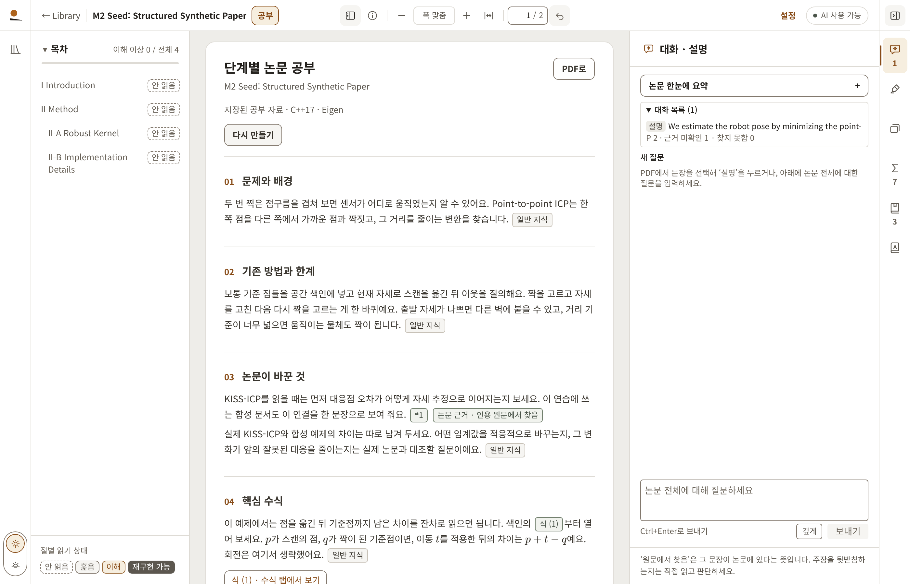](docs/screenshots/study-path.png) | [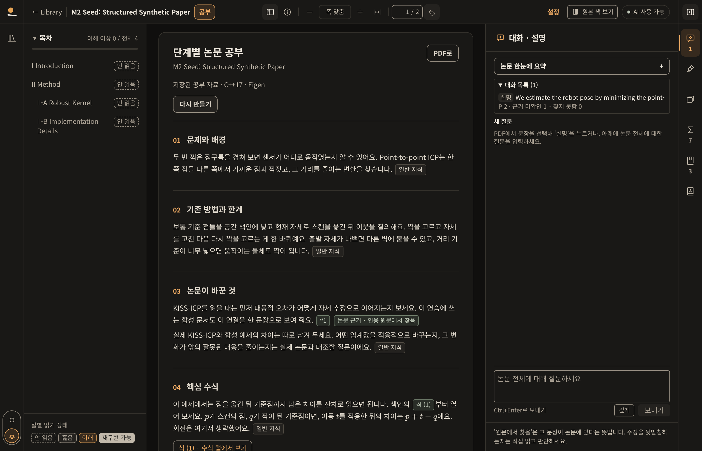](docs/screenshots/study-path-dark.png) |
| [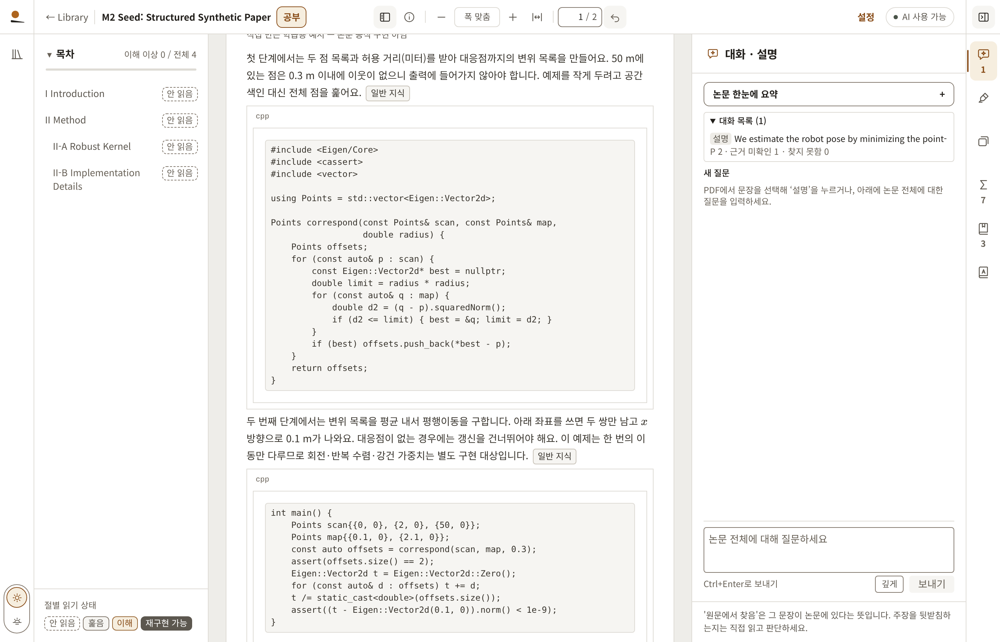](docs/screenshots/study-implementation.png) | [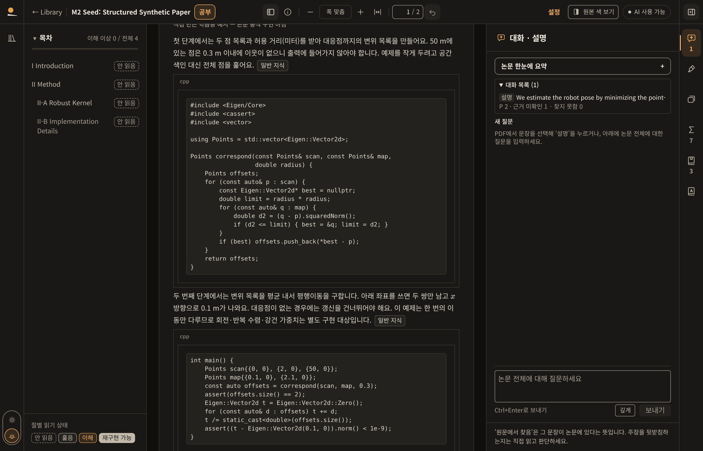](docs/screenshots/study-implementation-dark.png) |

리더에서 **공부 → 공부 자료 만들기**를 누르세요. 기존 방법과 그 한계에서 논문이 바꾼 부분, 식, 작은 실행 예제까지 이어 줍니다. 직접 해 본 항목에 체크하면 다시 열 때도 그 자리에 남습니다. 설정에서 다음 자료의 예시 언어를 C++17·Eigen 또는 Python으로 고를 수 있습니다.

### 참고문헌 찾아보기

| Light | Dark |
| --- | --- |
| [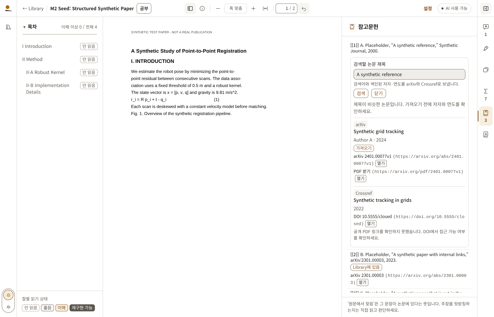](docs/screenshots/references.png) | [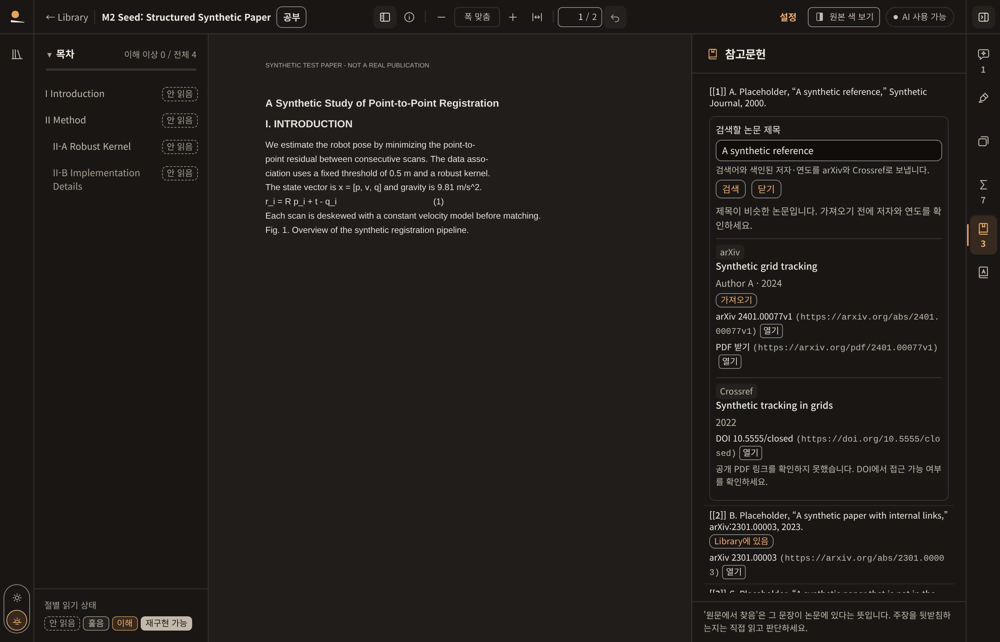](docs/screenshots/references-dark.png) |

**참고문헌** 패널에서 ID가 없는 참고문헌에는 **찾아보기** 버튼이 생깁니다. 제목으로 arXiv와 Crossref를 검색해, arXiv 논문은 서재로 바로 가져오고, DOI를 열거나, 공개된 PDF를 받을 수 있습니다. DOI만 있을 때는 그 사실을 솔직히 알려 줍니다.

## AI 설정

서재나 리더에서 **설정**을 열어 Sunlight가 Claude에 연결하는 방식을 고르세요. 이 컴퓨터의 `claude` CLI에 이미 로그인했다면 **Claude Code 구독**을 고르면 됩니다. 자기 키로 쓰려면 아래 세 단계를 따르세요.

| Light | Dark |
| --- | --- |
| [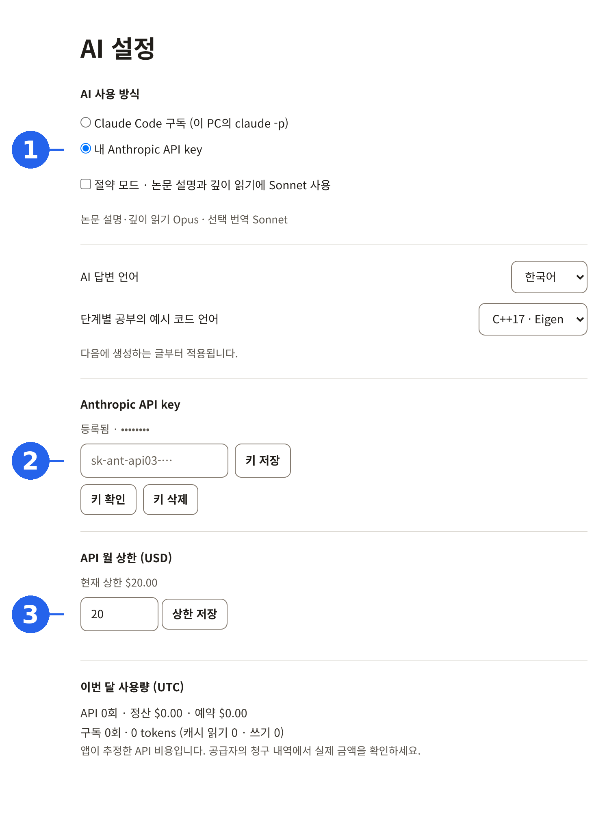](docs/screenshots/ai-settings-steps.png) | [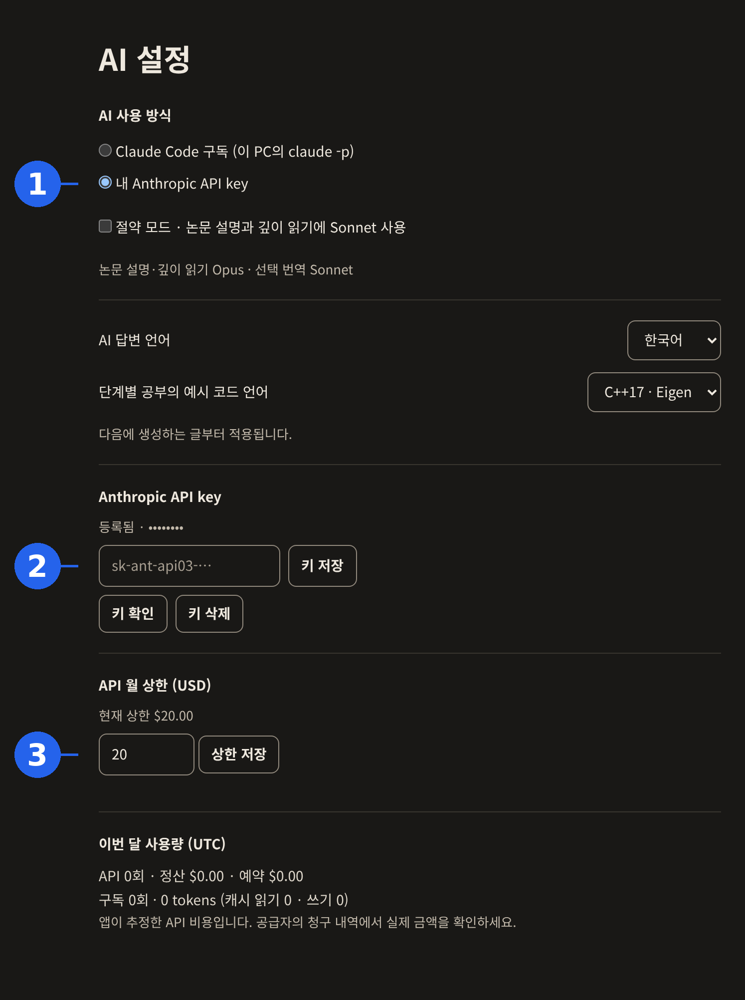](docs/screenshots/ai-settings-steps-dark.png) |

1. **방식 선택.** **AI 사용 방식**에서 **내 Anthropic API key**를 고릅니다.
2. **키 저장.** `sk-ant-api03-…` 키를 칸에 붙여 넣고 **키 저장**을 누릅니다. 키는 이 컴퓨터에만 저장되고, 화면에 **등록됨 · ••••••••**로 표시됩니다. **키 확인**은 답변을 생성하지 않고 모델 접근만 확인하며, **키 삭제**로 지울 수 있습니다.
3. **월 상한 설정.** **API 월 상한**에 USD 금액을 넣고 **상한 저장**을 누릅니다(20달러가 제안값). 첫 API 질문 전에 상한을 저장해야 합니다.

**이번 달 사용량**에서 구독 토큰, API 정산액, 처리 중인 요청에 잡아 둔 금액을 볼 수 있습니다. 최종 사용량이 오기 전에 연결이 끊기면 예약액이 남습니다. 상한과 추정 금액은 이 설치본에만 적용되니 실제 청구액은 Anthropic 계정에서 확인하세요. SDK는 모의 응답으로 시험했고 실제 키 인증과 청구 금액은 미검증입니다.

## 데이터와 개인정보

서버는 이 컴퓨터에서만 접속할 수 있습니다. PDF와 노트, SQLite DB는 `${XDG_DATA_HOME:-~/.local/share}/study_paper/`(Windows에서는 `%APPDATA%\Sunlight`)에 쌓입니다. 바로 옆의 `study_paper-config/`에는 실행 설정이, `study_paper-secrets/`에는 키가 들어갑니다. Linux와 macOS에서는 키 파일을 내 OS 계정만 읽을 수 있게 0600, 폴더는 0700으로 저장합니다. Windows에서는 이 POSIX 권한이 적용되지 않습니다. 데이터는 사용자별 `%APPDATA%` 프로필 아래에 있고, 앱이 추가로 해당 폴더를 내 계정으로 제한하는 ACL을 시도합니다(실패해도 계속 진행). 논문 백업에는 키가 들어가지 않습니다.

ID로 가져올 때는 arXiv에 접속합니다. 로컬 PDF를 서재에 넣는 작업은 이 컴퓨터에서 끝납니다. AI에 질문하면 선택한 공급자에게 요청에 필요한 내용을 보냅니다. 질문에 따라 논문 PDF, 본문, 선택한 그림도 함께 보낼 수 있습니다.

## 개발

개발용 데이터·설정·키를 형제 폴더로 지정하세요. 브라우저 시험에는 로컬 Google Chrome이 필요합니다.

```sh
export SP_DATA_DIR="$PWD/.sunlight-dev/data"
export SP_CONFIG_PATH="$PWD/.sunlight-dev/config/config.json"
export SP_SECRETS_DIR="$PWD/.sunlight-dev/secrets"
export SP_LLM=mock SP_NETWORK=off
npm run typecheck
npm test
npm run build
npm run check:licenses
npm run test:e2e
```

PDF 표시에는 [PDF.js](https://github.com/mozilla/pdf.js), 수식에는 [KaTeX](https://github.com/KaTeX/KaTeX), 저장에는 SQLite, API 연결에는 [Anthropic 공식 SDK](https://github.com/anthropics/anthropic-sdk-typescript)를 사용합니다. Sunlight는 [MIT 라이선스](LICENSE)로 배포합니다. [외부 구성요소 라이선스](THIRD_PARTY_NOTICES.md)
