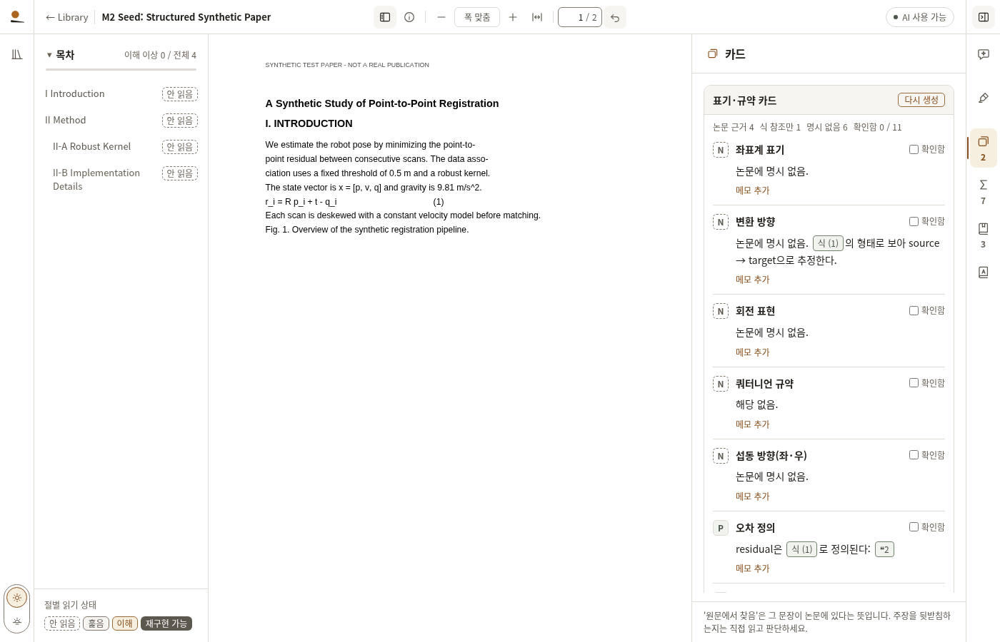
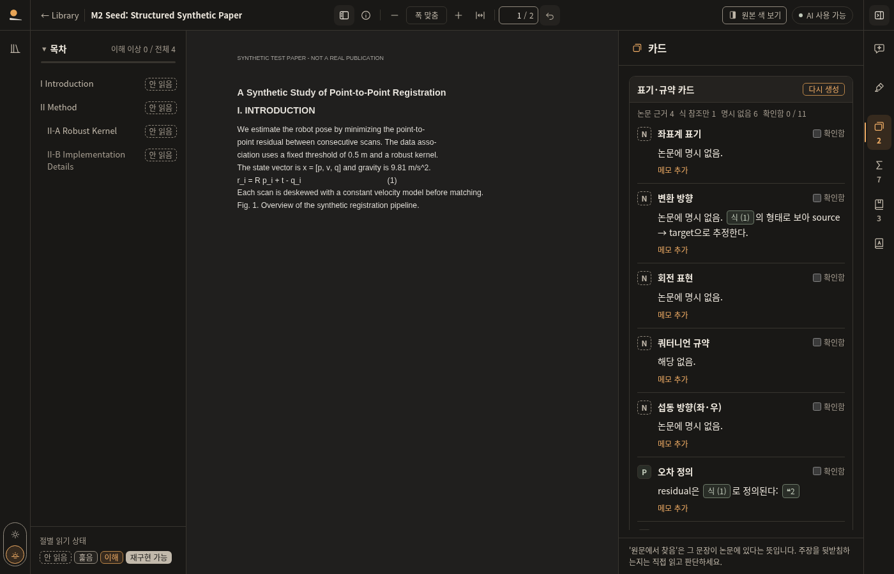

# Sunlight

[English](README.md) · [빠른 시작](#빠른-시작) · [AI 설정](#ai-설정) · [MIT 라이선스](LICENSE)

Sunlight는 내 컴퓨터에서 쓰는 논문 리더입니다. 읽다가 막히는 문단을 선택해 Claude에게 물어보세요. 답에 원문과 대조한 인용이 있으면, 눌러서 PDF의 해당 문장을 확인하고 읽던 곳으로 돌아갈 수 있습니다.

| 밝은 테마 | 어두운 테마 |
| --- | --- |
| [](docs/screenshots/reader-light.png) | [](docs/screenshots/reader-dark.png) |

## 빠른 시작

Linux x64(glibc)에서 **Node.js 22.23.5와 npm 10**을 준비하세요. nvm을 쓴다면 내려받은 폴더에서 `nvm install`을 실행하면 됩니다. 같은 폴더에서 아래 세 줄을 실행하세요.

가장 빠른 방법은 [Node.js](https://nodejs.org) 22 이상을 설치한 뒤:

```sh
./start.sh
```

설치·빌드·실행을 한 번에 합니다. 찍히는 `http://127.0.0.1:…` 주소를 열고, 끌 때는 Ctrl+C를 누르세요.

Node는 [nodejs.org](https://nodejs.org)나 nvm으로 설치하세요(배포판 `npm` 패키지는 깨져 있는 경우가 많습니다). 직접 단계별로 하려면:

```sh
npm ci
npm run build
npm run start:user -- --user-data
```

서재에 arXiv ID를 붙여 넣거나 **PDF 올리기**에서 파일을 고르세요. 50 MiB까지 끌어다 놓을 수도 있습니다. 논문을 가져오면 AI를 설정하기 전에도 읽고, 문장에 표시하고, 노트를 남길 수 있습니다. 다 읽고 서버를 끄려면 터미널에서 **Ctrl+C**를 누르세요. [서재 열기](http://127.0.0.1:4310/)

기본 포트를 이미 쓰고 있다면 `SP_PORT=4595 npm run start:user -- --user-data`로 실행하세요. [4595번 포트로 열기](http://127.0.0.1:4595/)

## 논문 한 편 읽기

파일로 올린 논문은 PDF에 기록된 제목이나 파일명으로 표시됩니다. 서재에서 제목을 고칠 수 있습니다. 책갈피가 있으면 목차로 쓰고, 없으면 글자 크기와 배치에서 절 제목을 찾습니다. 스캔본은 목차나 선택할 글자가 없을 수 있습니다.

선택 설명·번역, 카드와 단계별 공부는 파일로 올린 논문에서도 쓸 수 있습니다. LaTeX 원문이 없는 PDF는 인용을 미확인으로 표시하고 수식 깊이 읽기를 제공하지 않습니다. 큰 문서의 AI 설명에는 본문 일부를 발췌해 씁니다.

수식을 읽다가 낯선 기호를 만나면 PDF 옆에 표기 카드를 열어 보세요. 다음 식이 어떤 전제에서 나왔는지 궁금하면 가정 카드를 살펴보세요. 본문에 나온 식 번호로 이동하거나 참고문헌에서 저자가 어느 논문을 가리켰는지도 확인할 수 있습니다.

설명이 필요한 문장은 드래그하고 **E**를 누르세요. 번역은 **T**, 직접 질문을 쓰려면 **C**입니다. 그림의 일부분만 묻고 싶다면 **Ctrl**을 누른 채 그 부분을 드래그하세요. Dark 테마에서도 도표는 원래 색으로 돌려볼 수 있습니다.

다음에 다시 볼 문장에는 하이라이트를 남기세요. 왜 표시했는지도 적어 두고 싶다면 **N**으로 노트를 엽니다. 한 절을 다 읽었으면 목차에서 읽기 상태를 바꾸고, 다음 절에도 나올 만한 용어는 용어집에 저장해 두세요.

직접 구현해 보고 싶다면 리더에서 **공부 → 공부 자료 만들기**를 누르세요. 기존 방법이 어디에서 막혔는지 읽고, 논문에서 바꾼 부분을 식과 예시 코드로 이어 보세요. 직접 확인한 항목에 체크하면 다음에 열 때도 그 자리에 남습니다. 예시는 기본 C++17·Eigen이며, 설정에서 Python을 고르고 **다시 만들기**를 누르면 새 언어로 읽을 수 있습니다.

## AI 설정

서재나 리더에서 **설정**을 여세요. 이 컴퓨터의 `claude` CLI에 이미 로그인했다면 **Claude Code 구독**을 고르면 됩니다.

자기 키로 쓰려면 **내 Anthropic API key**를 고르고 추론용 키를 붙여 넣은 뒤 **키 저장**을 누르세요. **키 확인**은 답변을 생성하지 않고 모델 접근 권한만 확인합니다. 키를 바꾸거나 지울 때도 같은 화면을 쓰세요.

첫 API 질문을 보내기 전에 월 상한(USD)을 저장하세요. 처음 보이는 20달러는 제안 금액입니다. 설정에서 이번 달 구독 토큰, API 정산액, 처리 중인 요청에 잡아 둔 금액을 확인할 수 있습니다. 최종 사용량이 오기 전에 연결이 끊기면 예약액이 남습니다. 상한은 이 설치본에 적용되며 실제 청구액은 Anthropic 계정에서 확인할 수 있습니다. SDK는 모의 응답으로 시험했고 실제 키 인증과 청구 금액은 미검증입니다.

## 데이터와 개인정보

서버는 이 컴퓨터에서만 접속할 수 있습니다. PDF와 노트, SQLite DB는 `${XDG_DATA_HOME:-~/.local/share}/study_paper/`에 쌓입니다. 바로 옆의 `study_paper-config/`에는 실행 설정이, `study_paper-secrets/`에는 키가 들어갑니다. 키 파일은 내 OS 계정만 읽을 수 있게 0600, 폴더는 0700으로 저장합니다. 논문 백업에는 키가 들어가지 않습니다.

ID로 가져올 때는 arXiv에 접속합니다. 로컬 PDF를 서재에 넣는 작업은 이 컴퓨터에서 끝납니다. AI에 질문하면 선택한 공급자에게 요청에 필요한 내용을 보냅니다. 질문에 따라 논문 PDF, 본문, 선택한 그림도 함께 보낼 수 있습니다.

## 개발

개발용 데이터·설정·키를 형제 폴더로 지정하세요. 브라우저 시험에는 로컬 Google Chrome이 필요합니다.

```sh
export SP_DATA_DIR="$PWD/.sunlight-dev/data"
export SP_CONFIG_PATH="$PWD/.sunlight-dev/config/config.json"
export SP_SECRETS_DIR="$PWD/.sunlight-dev/secrets"
export SP_LLM=mock SP_NETWORK=off
npm run typecheck
npm test
npm run build
npm run check:licenses
npm run test:e2e
```

PDF 표시에는 [PDF.js](https://github.com/mozilla/pdf.js), 수식에는 [KaTeX](https://github.com/KaTeX/KaTeX), 저장에는 SQLite, API 연결에는 [Anthropic 공식 SDK](https://github.com/anthropics/anthropic-sdk-typescript)를 사용합니다. Sunlight는 [MIT 라이선스](LICENSE)로 배포합니다. [외부 구성요소 라이선스](THIRD_PARTY_NOTICES.md)
