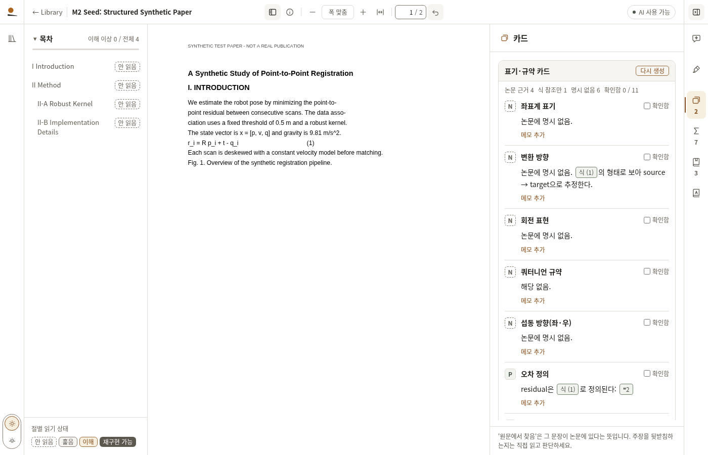
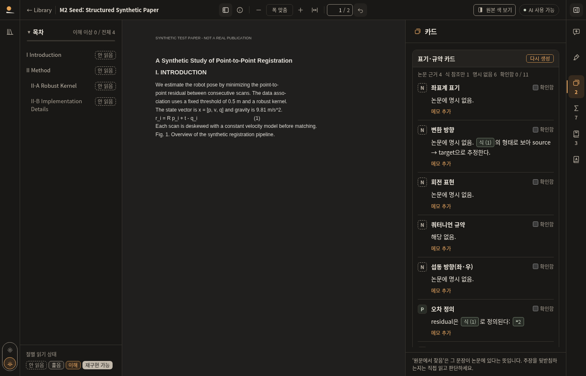
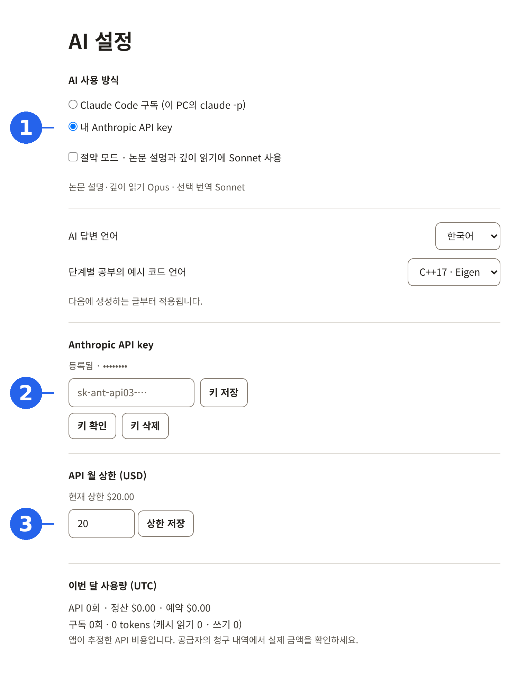

# Sunlight (study_paper)

[한국어](README.ko.md) · [Quick start](#quick-start) · [AI settings](#ai-settings) · [MIT license](LICENSE)

Sunlight is a paper reader that runs on your computer. When you get stuck on a paragraph, select it and ask Claude. Click a verified quote in the answer to see the line in the PDF, then pick up where you left off.

| Light | Dark |
| --- | --- |
| [](docs/screenshots/reader-light.png) | [](docs/screenshots/reader-dark.png) |

## Quick start

On Linux x64 with glibc, you'll need **Node.js 22.23.5 and npm 10**. If you use nvm, `nvm install` picks up the version from the repository. Run these commands from your checkout.

The quickest way, once you have [Node.js](https://nodejs.org) 22+ installed:

```sh
./start.sh
```

That installs, builds and starts the app. Open the `http://127.0.0.1:…` address it prints; press Ctrl+C to stop.

Install Node from [nodejs.org](https://nodejs.org) or nvm, not your Linux distribution's `npm` package (it is often broken). Or do the steps yourself:

```sh
npm ci
npm run build
npm run start:user -- --user-data
```

Open the library and paste in an arXiv ID, or drop a local PDF (up to 50 MiB) beside the import box. Once the paper is there, you can read, highlight, and take notes before setting up AI. Press **Ctrl+C** in the terminal when you're done. [Open Sunlight](http://127.0.0.1:4310/)

If the default port is busy, run `SP_PORT=4595 npm run start:user -- --user-data` and open the alternate address. [Open port 4595](http://127.0.0.1:4595/)

### Windows (native)

Native Windows support is new — **community testing is welcome, and it is not yet broadly verified on Windows.** If something misbehaves, the Linux steps also work inside WSL (below).

You need **[Node.js 22 LTS](https://nodejs.org)** (the Windows `.msi` installer) and, to clone the repository, **[Git for Windows](https://git-scm.com/download/win)** — or download the repository as a ZIP and extract it. Then, in **PowerShell**, from the folder you cloned or extracted:

```powershell
.\start.ps1
```

That installs, builds and starts the app. If PowerShell says running scripts is disabled, start it once with `powershell -ExecutionPolicy Bypass -File .\start.ps1`. Open the `http://127.0.0.1:…` address it prints (paste it into your browser); press **Ctrl+C** in the window to stop.

Or do the steps yourself:

```powershell
npm ci
npm run build
npm run start:user -- --user-data
```

Your papers, notes and settings live in `%APPDATA%\Sunlight` (next to it, `study_paper-config\` and `study_paper-secrets\`). The database engine (better-sqlite3) ships a prebuilt binary for 64-bit Windows, so no compiler is needed for a normal install. Only if `npm ci` reports it cannot load the SQLite native module (an unusual Node or CPU-architecture combination) install the **[Visual Studio Build Tools](https://visualstudio.microsoft.com/downloads/)** with the “Desktop development with C++” workload and run `npm ci` again.

### Windows (WSL)

The Linux instructions above work unchanged inside **WSL** (Windows Subsystem for Linux): install Node 22 in your WSL distribution and run `./start.sh`. Open the printed `http://127.0.0.1:…` address in your Windows browser.

## Read a paper

For a local PDF, Sunlight takes the title from its metadata or filename. You can edit it in the library. Bookmarks become the table of contents. If the PDF has no bookmarks, Sunlight looks for headings in the text layout. An image-only scan may have no outline or selectable text.

You can ask about a passage, translate it, make cards or follow a Study path. For a PDF without a LaTeX source, quotes stay unverified and equation deep reading is unavailable. Large documents use sampled text for AI context.

Say an equation uses a symbol you don't recognize. Open the notation cards beside the PDF and look up the symbol. If the next step depends on an assumption, open the assumption cards. You can also jump to an indexed equation or check which paper a reference points to.

For a difficult passage, select the text and press **E** for an explanation, or **T** for a translation. If you have a particular question, press **C** and type it. For a figure, hold **Ctrl** and drag around the part you want to ask about. In dark mode you can switch the figure back to its original colors.

Before closing the paper, highlight the line you want to revisit or press **N** to leave yourself a note. Save a term in the glossary or mark your reading progress in the outline when you finish a section.

Want to implement the method yourself? Open **공부** (Study path) in the reader and choose **공부 자료 만들기**. Work from the earlier method and its limits to the paper’s changes, equations and runnable examples. Check off what you have tried. Reopening the paper keeps your guide and checks. Settings lets you choose C++17 with Eigen or Python for the next guide you generate.

## AI settings

Open **설정** (Settings) from the library or reader to choose how Sunlight reaches Claude. If you are already signed in to the `claude` CLI on this computer, choose **Claude Code 구독** to use your subscription. To use your own Anthropic key instead, follow the three steps below.

[](docs/screenshots/ai-settings-steps.png)

1. **Choose the backend.** Under **AI 사용 방식**, select **내 Anthropic API key**.
2. **Save your key.** Paste your `sk-ant-api03-…` key into the field and click **키 저장**. It is stored only on this computer, and the screen then shows **등록됨 · ••••••••**. Click **키 확인** to confirm model access — that check generates no answer — or **키 삭제** to remove the key.
3. **Set a monthly cap.** Enter a USD amount under **API 월 상한** and click **상한 저장** ($20 is suggested). You must save a cap before the first API question.

**이번 달 사용량** shows subscription tokens, API spending, and amounts held for unfinished requests; if a connection drops before usage arrives, the hold stays in place. The cap and these estimates cover this installation only — check your Anthropic account for actual charges. We tested the SDK with a simulated provider; live authentication and billing are unverified.

## Data and privacy

The server listens only on this computer. PDFs, notes, and the SQLite database stay in `${XDG_DATA_HOME:-~/.local/share}/study_paper/` (on Windows, `%APPDATA%\Sunlight`). Next to it are `study_paper-config/` for optional settings and `study_paper-secrets/` for the key. On Linux and macOS the key file is readable only by your OS account (0600), inside a private directory (0700). On Windows those POSIX modes do not apply: the data lives under your per-user `%APPDATA%` profile, and the app additionally tries to restrict the folders to your account with an ACL (best-effort). Study-data backups exclude the key.

Importing by ID contacts arXiv. Dropping a PDF into the library stays local. When you ask for AI help, your chosen provider receives what the task needs. That can include your question, the paper or its text, and an image you selected.

## Development

For a scratch installation, keep data, config, and secrets in three sibling directories.

```sh
export SP_DATA_DIR="$PWD/.sunlight-dev/data"
export SP_CONFIG_PATH="$PWD/.sunlight-dev/config/config.json"
export SP_SECRETS_DIR="$PWD/.sunlight-dev/secrets"
export SP_LLM=mock SP_NETWORK=off
npm run typecheck
npm test
npm run build
npm run check:licenses
npm run test:e2e
```

Browser tests use locally installed Google Chrome. The maintainer runbook calls `npm run live:e2e -- <check-args|init|import|run|evaluate|post-check> …`. Its `RESUME=1 EVALUATE=1` mode rechecks saved results (LLM 0 calls). The reader uses [PDF.js](https://github.com/mozilla/pdf.js), [KaTeX](https://github.com/KaTeX/KaTeX), SQLite, and the official [Anthropic TypeScript SDK](https://github.com/anthropics/anthropic-sdk-typescript). Sunlight is [MIT licensed](LICENSE). Other components retain their own licenses. [Third-party notices](THIRD_PARTY_NOTICES.md)
